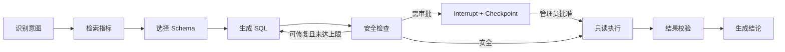

# 第 3～10 周主项目改造：交付、运行与代码阅读

本次在已有 Enterprise Data Copilot 和 MyBatis 查询模块上继续实现。改造前工作区已有未提交内容；本次保留这些内容，不创建新的替代项目。学习检查题放在文末，开发过程不因答题而暂停。

## 1. 按路线对应实现

| 周次 | 实现 | 主要代码/交付物 |
| --- | --- | --- |
| 第 3 周 | 按租户、创建者、状态、数据源和稳定分页顺序建立复合索引；临时表 EXPLAIN 实验 | `V7__job_search_indexes.sql`、`app/evaluation/query_plans.py` |
| 第 4 周 | 沿用 Markdown/PDF 解析、带重叠切分、来源定位与版本化；沿用 24 条人工问答映射 | `app/retrieval/parsing.py`、`rag-gold-v1.jsonl` |
| 第 5 周 | 真实 HTTP Embedding、离线哈希基线、精确/近似向量检索、混合检索、HTTP Reranker、四组评测 | `providers.py`、`benchmark.py`、`V8__embedding_profiles.sql` |
| 第 6 周 | 稳定错误分类、有限重试、修复次数配置、脱敏事件、审批恢复与重复请求演示 | `app/agent/error_policy.py`、`steps.py`、`demo.py` |
| 第 7 周 | 六类实体/关系的结构化抽取、引用校验、原文证据/置信度/时间、人工样本 | `app/knowledge_graph/models.py`、`service.py`、`graph-gold-v1.jsonl` |
| 第 8 周 | Neo4j 持久化、实体链接、邻居与三跳内路径、图关系与文档证据问答、元数据导入 | `repository.py`、`service.py`、`metadata.py`、`cli.py` |
| 第 9 周 | 官方 MCP SDK 的只读工具；Java JWT/角色/审计/限流入口；ECharts 页面与联调 | `app/mcp_server.py`、`IntelligenceController.java`、`KnowledgeGraphView.tsx` |
| 第 10 周 | Compose 图数据库、环境配置、API 契约、验证命令、演示和面试材料 | 本文、`openapi-intelligence.yaml`、`docker-compose.full.yml` |

本文代码路径相对仓库根目录。Python 路径省略 `agent-service/` 前缀，Java 文件可按类名搜索。

## 2. 当前边界

- 默认 `hashing` 是可重复的离线测试替身，不代表真实语义模型。
- 默认重排关闭。`overlap` 是离线词重叠基线，`http` 才调用配置的重排服务。
- 图问答采用局部实体/路径扩展与文档检索融合，没有实现 Microsoft GraphRAG 的社区检测、社区摘要和全局搜索。
- 样本评测不等于真实业务效果。答案准确率需要独立人工评审，检索评测不伪装成答案评测。
- 数据库目录导入只读取表、字段与外键元数据，不导入客户明细或执行模型生成的 Cypher。
- 图谱来源按 `(tenant_id, source_id)` 替换；同名实体在不同来源中暂时保留不同身份，避免错误合并。实体链接会查找同名来源，但未实现跨来源消歧与统一实体注册表。
- 来源文本的访问权限沿用现有租户级知识库模型；目前没有增加文档级 ACL。管理员只能导入允许向本租户读者公开的资料。

## 3. 启动

在仓库根目录配置已有 `.env`。保留原有数据库、登录和模型配置，按 `.env.example` 补齐新增字段。

```bash
docker compose -f docker-compose.yml -f docker-compose.full.yml up -d --build
docker compose -f docker-compose.yml -f docker-compose.full.yml ps
```

Java 启动时由 Flyway 执行 V7/V8。V8 保留现有 64 维向量，改为可变维向量列，并为每个 chunk 记录 Embedding Profile。它不会自动调用外部模型重新嵌入历史文档。

访问：

- Web：`http://localhost:3000`
- Java：`http://localhost:8080/health`
- Python：`http://localhost:8000/health`
- Neo4j Browser：`http://localhost:7474`
- Prometheus：`http://localhost:9090`

本次本机的 3000 端口已有另一个应用，已在忽略提交的 `.env` 中将本项目 `WEB_PORT/WEB_HTTP_PORT` 设为 3100。因此本次交付实际网页地址为 `http://localhost:3100`，其他应用进程保持运行。

关系网络入口已加入工作台导航。首次进入没有图节点时，可搜索空字符串浏览已有图，或由管理员展开抽取面板导入文本。

只在宿主机运行 Python 时，使用 `GRAPH_URI=bolt://localhost:7687`。Compose 内使用 `bolt://neo4j:7687`。Embedding/Reranker 在宿主机运行时，容器配置使用 `host.docker.internal`；宿主机直接运行时使用 `localhost`。

不要通过删除数据库卷解决迁移问题。先检查 Java 的 Flyway 日志和实际数据库版本。

## 4. 第 3 周：SQL 与查询优化

已有请求链路：

```text
GET /api/analysis/jobs/search
→ AnalysisJobSearchController
→ AnalysisJobQueryService（从 JWT 得出租户与 owner 条件）
→ AnalysisJobSearchMapper.xml
→ COUNT + 有界分页查询
→ 同租户 data_sources / app_users JOIN
```

V7 的四个索引对应管理员分页、非管理员 owner 分页、状态筛选和数据源筛选。相同时间戳使用 `id` 作为第二排序键，避免分页顺序不稳定。现有 LIKE 搜索仍是子串查询，不能声称 B-tree 能加速任意 `%keyword%`；大量文本搜索应再根据真实执行计划评估 trigram/全文索引。

运行可回滚的对照实验：

```bash
cd agent-service
uv run python -m app.evaluation.query_plans \
  --rows 100000 --output ../evaluation/northwind/week3-query-plans.json
```

工具只创建当前事务的临时表，并在 finally 中 rollback；不删除或修改业务表。报告保留完整 JSON 执行计划、缓存块指标和执行耗时。

本次 10 万行合成数据实测：顺序扫描约 2.583 ms，增加复合索引后约 0.346 ms，计划变为 Bitmap Index/Heap Scan。该数字只说明这个临时数据分布的结果，不能写成真实业务接口加速倍数。

CTE 和窗口函数实验可按下面顺序扩展练习：先筛选当前租户任务，在 CTE 内按状态分组，再使用 `row_number()` 取每种状态最近任务，最后 JOIN 数据源名称。检查聚合前后行数是否变化，以及 LIMIT 是否发生在正确阶段。

## 5. 第 4～5 周：RAG 链路与模型配置

```text
管理员上传 Markdown/PDF
→ 解析章节/页码 → 带重叠切分 → Embedding Provider
→ 版本化文档与 pgvector chunks → 租户缓存失效

查询 → 关键词 / 向量候选 → 加权 RRF
→ 可选 Reranker → 证据阈值 → 带版本的来源引用
```

真实 Embedding 配置示例（维度必须匹配所选模型的实际输出）：

```dotenv
RAG_EMBEDDING_PROVIDER=http
RAG_EMBEDDING_BASE_URL=http://host.docker.internal:11434/v1
RAG_EMBEDDING_MODEL=nomic-embed-text
RAG_EMBEDDING_DIMENSIONS=768
RAG_VECTOR_SEARCH_MODE=exact
RAG_PROVIDER_TIMEOUT_SECONDS=15
RAG_PROVIDER_MAX_ATTEMPTS=2
```

Embedding 接口约定：`POST {base_url}/embeddings`，请求包含 `model` 与 `input: string[]`，响应包含 `data: [{index, embedding}]`，可带 `usage.prompt_tokens`。适配器分批调用、校验数量和索引、拒绝错误维度/零向量/NaN，并归一化向量。HTTP 超时和 429/5xx 可以有限重试，401 等永久错误不重试。

Profile 包含端点指纹、模型名和维度。同维度不同模型也不能混用。切换配置后，必须通过原有上传接口重新上传当前租户全部活动文档；在完成前，向量查询返回 `RAG_REINDEX_REQUIRED`。关键词模式仍可使用。不要通过截断或补零强行兼容不同维度。

默认 `exact` 先物化租户候选再计算距离，优先保证带过滤条件的召回。`approximate` 使用 HNSW 并启用 pgvector iterative scan，需先在真实租户分布上测 Recall@5。迁移包含 64/1536 维部分 HNSW 索引；其他维度默认精确检索，可再按评测结果增加相应维度的部分索引。

真实重排配置：

```dotenv
RAG_RERANKER_PROVIDER=http
RAG_RERANKER_URL=http://host.docker.internal:8001/rerank
RAG_RERANKER_MODEL=BAAI/bge-reranker-v2-m3
```

接口约定：请求 `model/query/documents/top_n`，响应 `results: [{index,relevance_score}]`。当前要求返回全部候选且每个索引只出现一次，再由服务取 top-k。服务地址与 API Key 由部署配置提供，客户端不能覆盖。

四组离线评测：

```bash
cd agent-service
uv run python -m app.retrieval.benchmark \
  --document ../knowledge/northwind/retail-metrics-v1.md \
  --cases ../evaluation/northwind/rag-gold-v1.jsonl \
  --output ../evaluation/northwind/week5-retrieval-offline.json
```

真实服务评测使用同一命令的 `--configured --tenant-id <当前租户UUID>`，先通过平台完成该租户文档入库。此模式不自动修改语料。配置的 Reranker 必须可用，否则第四组会明确失败，不悄悄替换成词重叠算法。

报告包含真正按相关章节比例计算的 Recall@5、MRR、拒答准确率、平均/P95 延迟、失败样本、Embedding 请求/Token 和重排次数。可以提供 `--embedding-price-per-million`、`--reranker-price-per-thousand` 得到每组费用估算。供应商未返回 usage 或未填写单价时，费用为 null。

现有 24 条评测有 20 条可回答、4 条拒答。离线报告仅验证哈希与词重叠基线，PostgreSQL 的中文分词效果还需要独立测试，不能把内存分词的分数套到数据库上。

## 6. 第 6 周：Agent 状态、恢复与事件



`AGENT_WORKFLOW_MAX_REPAIRS` 支持 0～2。LLM 和检索适配器各自限制网络重试，不在 SQL 执行外增加无界重试。错误事件记录 category/retryable、稳定错误码与耗时，不包含原始异常正文、密钥和业务结果。

审批 Interrupt 是正常控制流，不再错误记录为 FAILED。人工恢复时使用 Java 已验证的审批决策；重复 start 读取已有检查点，不重复执行已完成任务。

无需模型服务的演示：

```bash
cd agent-service
uv run python -m app.agent.demo
```

演示包含一次 SQL 修复、一次审批暂停后恢复、一次重复请求。每条成功流程断言 SQL 只执行一次。该演示使用内存检查点；跨进程的生产持久化继续使用现有 PostgreSQL Checkpointer，由现有集成测试覆盖。

## 7. 第 7～8 周：结构化抽取与 GraphRAG

实体：Metric / Table / Column / BusinessTerm / Document / DataSource。

关系：DEFINED_IN / DERIVED_FROM / USES_COLUMN / BELONGS_TO / RELATED_TO / JOINS_WITH。

```text
ADMIN 来源文本
→ StructuredLLMClient + Pydantic Schema
→ 检查实体唯一性、关系端点与原文连续引用
→ 服务端补充来源、时间、稳定身份
→ Neo4j 单事务替换来源图

业务问题 → 名称匹配实体 → 两跳邻居 + 关系证据
        ↘ 混合检索文档 → 有界上下文 → 结构化回答 → 检查引用 ID
```

Neo4j 用 `(tenant_id,id)` 约束身份。替换图前锁定 GraphSource；节点、关系、路径的查询都限制租户。客户端不能提交 Cypher，深度最多 3，返回最多 100 节点/200 边；问答上下文预算约 32k 字符，优先关系证据。

公开接口（均需平台 JWT）：

- `POST /api/graph/extract`：ADMIN，body 为 `source_id/source_name/text`。
- `POST /api/graph/search`：`query/depth/limit`。
- `POST /api/graph/path`：`source/target/depth`。
- `POST /api/graph/answer`：业务问题放在 `query`。
- `POST /api/knowledge/search`：`query/mode/limit`。

相同 source_id 再次抽取会原子替换该租户、该来源的子图。不同租户同样的 source_id 不会相互覆盖。

不调用模型的数据库目录导入（运维命令，需要 Neo4j 凭据与正确租户）：

```bash
cd agent-service
uv run python -m app.knowledge_graph.cli \
  --metadata ../metadata/northwind-schema-v1.json --tenant-id <当前租户UUID>
```

导入表、字段、数据源和外键关系，适合在没有模型额度时验证图页面。源是已保存的目录快照，不读取真实业务行。该操作不会生成业务指标间的模型抽取关系。

人工校验样本：`evaluation/northwind/graph-gold-v1.jsonl`。

```bash
cd agent-service
uv run python -m app.knowledge_graph.evaluation \
  --cases ../evaluation/northwind/graph-gold-v1.jsonl \
  --output ../evaluation/northwind/week7-extraction-offline.json
```

默认 Gold Replay 只验证 Schema、引用与持久化逻辑。加入 `--configured-model` 才会调用当前模型，对抽取关系计算 Precision/Recall/F1。三条英文样本只能作为起点，需要补充中文业务文档、跨段关系、同名实体和错误引用样本。

## 8. 第 9 周：MCP 与前端

外部 MCP 客户端连接 `http://localhost:8080/api/mcp`，使用平台登录得到的 Bearer JWT。采用官方 Python MCP SDK，stateless Streamable HTTP，JSON response 模式；请求 Accept 同时包含 `application/json, text/event-stream`。

当前工具：

| 工具 | 内容 | 权限边界 |
| --- | --- | --- |
| search_knowledge | 文档检索与来源 | 当前租户 |
| metric_definition | 指标口径检索 | 当前租户 |
| relationship_graph | 受限邻居图 | 当前租户、深度≤3 |
| search_catalog | 数据源目录 | 复用 Java 数据源查询；只返回名称、ID、schema |
| job_status | 任务状态 | 复用 Java owner/tenant 校验；不返回 SQL 或结果行 |

资源 `copilot://capabilities` 返回只读能力说明。没有 SQL 执行、图写入或任意文件工具。

Java 验证 JWT 后覆盖身份头，通过服务令牌调用 Python；MCP 直连 Python 仍需要服务身份。每租户/用户每分钟最多 60 次新增智能接口请求，Redis 原子计数；审计记录成功/失败/限流。调用有连接、读取和响应大小上限。

初始化请求示例：

```json
{"jsonrpc":"2.0","id":1,"method":"initialize","params":{"protocolVersion":"2025-11-25","capabilities":{},"clientInfo":{"name":"portfolio-demo","version":"1.0"}}}
```

随后发送 `notifications/initialized`、`tools/list`，再发送：

```json
{"jsonrpc":"2.0","id":2,"method":"tools/call","params":{"name":"metric_definition","arguments":{"name":"Revenue"}}}
```

前端关系网络支持：搜索、层数、节点和关系类型筛选、拖动缩放、邻居高亮、来源/置信度/证据面板、三跳内路径、证据问答、管理员文本抽取。Canvas 图使用 ECharts，Tooltip 不渲染 HTML，原文通过 React 文本节点显示。节点列表提供键盘可访问的证据入口。

## 9. 验证命令

```bash
# Python 单元/协议/契约测试
cd agent-service
uv run ruff check app tests
uv run pytest -q -m 'not integration'

# 实际 PostgreSQL/pgvector；只使用测试 schema
RUN_P6_INTEGRATION=1 uv run pytest -q tests/test_p6_integration.py

# 实际隔离 Neo4j；使用随机测试租户并清理该租户
GRAPH_INTEGRATION_URI=bolt://localhost:7687 \
GRAPH_INTEGRATION_PASSWORD=<测试Neo4j密码> uv run pytest -q tests/test_graph_integration.py

# Java；Testcontainers 需要 Docker
cd ../platform-api
./mvnw test

# Web
cd ../web
pnpm typecheck
pnpm lint
pnpm test
pnpm build
```

本次已验证：Java 全套 64 项通过；Python 全套 213 项通过（含隔离 PostgreSQL、只读业务库、Neo4j、持久化审批恢复）；Web 类型、静态检查、7 项测试和生产构建通过；三个应用镜像构建成功；完整 Compose 启动健康；实际登录/检索/MCP 的 10 项只读联调通过。详见 `docs/evidence/week3-10-validation.md` 与 `week3-10-smoke.json`。

## 10. 演示与面试

三分钟版本：

1. 30 秒：说明 Java 管身份/权限/任务，Python 管 AI，数据库只读执行。
2. 45 秒：展示 MyBatis 筛选分页和查询计划，说明复合索引对应哪个 WHERE/ORDER BY。
3. 45 秒：展示四种检索报告，解释真实模型和离线替身的区别。
4. 45 秒：在关系网络搜索实体，点开关系证据，问“Revenue 使用哪些字段”。
5. 15 秒：展示 MCP 五个只读工具和一次权限拒绝。

十分钟版本：在三分钟内容上加入文档版本更新、模型配置改变后的重新入库、审批恢复、跨租户访问拒绝、图谱来源替换以及一条检索失败样本。

建议录屏或截图：工作台关系网络、关系证据面板、GraphRAG 回答与引用、MCP tools/list、执行计划对比。必须来自实际运行环境，不用生成图冒充运行截图。

面试时可以准确表述：

> 我在原有多租户数据 Copilot 上补齐了 MyBatis 查询索引优化、可配置语义 Embedding 与四路检索评测、来源可追溯的 Neo4j 局部 GraphRAG、只读 MCP 工具和 ECharts 关系图。租户与角色仍由 Java 平台负责，Python 只接受可信服务身份。离线测试基线、真实数据库验证和真实模型效果分别记录。

## 11. 代码阅读与理解检查

按顺序阅读：`V7/V8` → `providers.py` → `retrieval/service.py` → `benchmark.py` → `error_policy.py/steps.py` → 图谱 `models.py/service.py/repository.py` → `mcp_server.py` → `IntelligenceController.java` → `KnowledgeGraphView.tsx`。

每个阶段至少独立回答：

1. 为什么同为 768 维的两个模型仍可能不能混用？代码在哪里阻止混用？
2. HNSW 与租户过滤结合时为什么可能损失召回？精确模式如何作为对照？
3. RRF 分数与重排模型分数为什么不能当作相同概率？
4. 原文中出现了一句话，是否就足以证明模型抽取的关系语义正确？还需要什么评测？
5. 为什么 source_id 不能单独作为图谱更新条件？并发替换靠什么保证一致？
6. 为什么 MCP 不能直接信任客户端提交的 tenant_id、角色或 owner_id？
7. 检索正确但答案仍然错误时，应怎样区分检索问题与生成问题？
8. 为什么人类审批的 Interrupt 不能记录为普通失败重试？

官方参考：[pgvector](https://github.com/pgvector/pgvector)、[Neo4j Python Driver](https://neo4j.com/docs/python-manual/current/)、[MCP Python SDK](https://github.com/modelcontextprotocol/python-sdk)、[ECharts Graph](https://echarts.apache.org/en/option.html#series-graph)。
