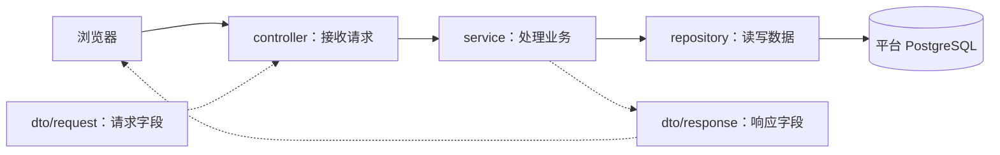
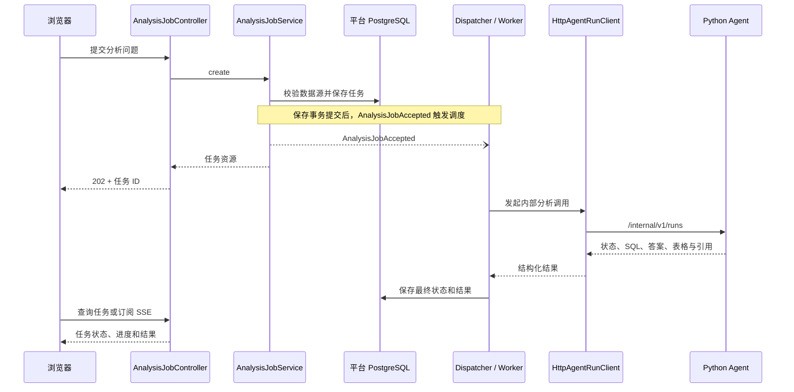

# Java 平台代码阅读指南

Java 层是一个 Spring Boot 应用，启动入口是 [PlatformApiApplication](src/main/java/com/example/copilot/PlatformApiApplication.java)。源码统一按职责分层：HTTP 请求先进入 Controller，由 Service 处理业务，再通过 Repository 读写平台数据库；需要执行 AI 分析时，由后台任务调用 Python Agent。

## 1. 先看整体目录

所有生产代码都在 `src/main/java/com/example/copilot/` 下：

```text
com.example.copilot
├── PlatformApiApplication.java    应用启动入口
├── controller/                    HTTP 接口：登录、分析、审批、文档、数据源、内部回调
├── service/                       业务处理：权限、幂等、事务、任务结果与 SSE
├── repository/                    平台 PostgreSQL 访问与 Redis 事件存取
├── entity/                        JPA 实体与分析任务状态转换规则
├── enums/                         任务状态、审批状态、用户角色
├── dto/
│   ├── request/                   API 请求参数
│   └── response/                  API 响应对象；Resource 是响应 DTO
├── task/                          后台任务调度、执行、分发租约
├── client/agent/                  Java 调用 Python 的客户端与内部响应对象
├── event/                         应用事件、进度事件与事务提交后的监听器
├── config/                        Security/线程池配置、开发演示数据初始化
│   └── properties/                从 application.yml/环境变量绑定的配置对象
├── security/                      从 JWT 读取当前用户、内部服务 token 校验
├── exception/                     业务异常与统一异常响应处理
└── common/                        trace ID 上下文与请求追踪过滤器
```

数据库结构、账号和环境变量不在这些包中：`src/main/resources/application.yml` 保存应用配置，`src/main/resources/db/migration/` 保存 Flyway 数据库迁移。

## 2. 普通请求怎么走



以登录为例，按这个顺序打开文件即可：

1. [AuthController](src/main/java/com/example/copilot/controller/AuthController.java)：找到 `/api/auth/login` 入口。
2. [LoginRequest](src/main/java/com/example/copilot/dto/request/LoginRequest.java)：查看浏览器提交的租户、邮箱、密码。
3. [AuthenticationService](src/main/java/com/example/copilot/service/AuthenticationService.java)：查看如何找租户、检查密码、签发 JWT。
4. [AppUserRepository](src/main/java/com/example/copilot/repository/AppUserRepository.java) 和 [TenantRepository](src/main/java/com/example/copilot/repository/TenantRepository.java)：查看数据库查询条件。
5. [AppUser](src/main/java/com/example/copilot/entity/AppUser.java)、[Tenant](src/main/java/com/example/copilot/entity/Tenant.java)、[TokenResponse](src/main/java/com/example/copilot/dto/response/TokenResponse.java)：查看存储结构和最终返回字段。

`SecurityConfiguration` 负责配置 JWT 验证与角色规则，`CallerIdentity` 负责从已验证的 JWT 中取出本次请求的用户和租户。初读业务代码时，可以先把它们理解成“确认当前是谁”。

## 3. 提交分析任务为什么要看 task

一次分析通常比普通 HTTP 请求慢，因此创建任务的请求会先返回任务 ID，后台继续执行。它有两段调用链：



建议按顺序阅读：

1. [AnalysisJobController](src/main/java/com/example/copilot/controller/AnalysisJobController.java)：创建、查询任务和订阅 SSE 的 HTTP 入口。
2. [AnalysisJobService](src/main/java/com/example/copilot/service/AnalysisJobService.java)：校验用户、租户、数据源、幂等键，保存任务，发布接收事件。
3. [AnalysisJobDispatcher](src/main/java/com/example/copilot/task/AnalysisJobDispatcher.java)：在事务提交后把任务放入线程池；启动时恢复未完成任务。
4. [AnalysisJobWorker](src/main/java/com/example/copilot/task/AnalysisJobWorker.java)：重新复核数据源、调用 Agent、处理重试、保存结果。
5. [HttpAgentRunClient](src/main/java/com/example/copilot/client/agent/HttpAgentRunClient.java)：实际向 Python 发送 HTTP 请求。
6. [AnalysisJob](src/main/java/com/example/copilot/entity/AnalysisJob.java) 和 [AnalysisJobStateMachine](src/main/java/com/example/copilot/entity/AnalysisJobStateMachine.java)：任务保存什么、允许怎样改变状态。

Python 回传步骤和申请审批时，入口是 [InternalAgentCallbackController](src/main/java/com/example/copilot/controller/InternalAgentCallbackController.java)，它分别调用 `AgentStepService` 和 `ApprovalService`。这条方向是 Python → Java；`client/agent` 中的客户端则用于 Java → Python。

SSE 的业务入口是 [AnalysisEventStreamService](src/main/java/com/example/copilot/service/AnalysisEventStreamService.java)。它通过 `RedisAnalysisEventStore` 保存和重放进度，再推送给浏览器。最终结果仍保存在 PostgreSQL。

## 4. 按功能找代码

| 想看什么 | Controller | Service / 后台处理 | 主要数据访问或外部调用 |
|---|---|---|---|
| 登录 | `AuthController` | `AuthenticationService` | `AppUserRepository`、`TenantRepository` |
| 数据源 | `DataSourceController` | `DataSourceManagementService` | `DataSourceRepository` |
| 分析任务 | `AnalysisJobController` | `AnalysisJobService`、`AnalysisJobWorker` | `AnalysisJobRepository`、`AgentRunClient` |
| 执行步骤 | `AgentStepController`、`InternalAgentCallbackController` | `AgentStepService` | `AgentStepRepository` |
| 人工审批 | `ApprovalController`、`InternalAgentCallbackController` | `ApprovalService` | `ApprovalRepository`、`AgentRunClient` |
| 指标文档 | `MetricDocumentController` | `MetricDocumentService` | `MetricKnowledgeClient`、`MetricDocumentRepository` |
| 审计记录 | 由其他业务操作触发 | `AuditService` | `AuditEventRepository` |
| 实时进度 | `AnalysisJobController` | `AnalysisEventStreamService` | `RedisAnalysisEventStore` |

Java 平台 Repository 访问的是平台数据。业务库中的 Northwind 销售查询由 Python 的只读执行器负责。

## 5. 测试在哪里

```text
src/test/java/com/example/copilot/
├── controller/        健康接口测试
├── entity/            任务状态机测试
├── client/agent/      WireMock 模拟 Python 500、超时和非法响应
├── config/            开发演示数据初始化与重复启动测试
├── common/            trace 上下文测试
├── integration/       登录/租户权限、审批、异步任务和 SSE 集成测试
└── support/           PostgreSQL / Redis Testcontainers 公共测试环境
```

Java 全量验证在 `platform-api` 目录运行 `./mvnw test`，Docker 必须已启动；格式检查使用 `./mvnw spotless:check`。仓库根目录的 `make verify-p8`、`make verify-p9` 等命令仍按原测试类名运行。

## 6. 从旧目录切换

原来 `analysis/api`、`approval/api` 等业务模块下的 Controller 统一移到 `controller`；请求和响应分别移到 `dto/request`、`dto/response`。各模块的 `service`、`repository`、实体和枚举也分别集中。

| 旧位置 | 现在的位置 |
|---|---|
| `*/api/*Controller`、内部回调、健康接口 | `controller` |
| `*/api/*Request` / `*Resource`、登录响应、错误响应 | `dto/request` / `dto/response` |
| `*/service/*Service`、SSE Service | `service` |
| `*/repository`、Redis 事件存取 | `repository` |
| `*/domain` | `entity`、`enums`、`exception` |
| `execution` | `task`、`event`、`config` |
| `integration/agent` | `client/agent`，内部回调移入 `controller` |
| 分散的配置与 bootstrap | `config`、`config/properties` |

接口 URL、JSON 字段、数据库表、迁移脚本和环境变量沿用现有定义。Maven 仍为单个 Spring Boot 工程，主启动类的包名仍是 `com.example.copilot`，可以扫描到全部下级包。

宿主机开发从旧包布局切换后，先停止旧 Java 进程，在 `platform-api` 目录执行一次 `./mvnw clean`，再回到仓库根目录运行 `make dev-platform`。这样可清除 `target` 中残留的旧包类，避免重复 Spring Bean。完整容器模式执行 `make stack-up` 重新构建应用镜像即可。

## 7. 本次分层重构的启动验收（2026-10-18）

使用本机 Java 21、真实 PostgreSQL 17 和 Redis 8.2 验证，不仅检查编译结果：

- `./mvnw --batch-mode clean verify spotless:check`：33 条 Java 测试全部通过，生产 JAR 构建成功，95 个 Java 文件通过格式检查。
- 从根目录运行 `make compose-up`、`make dev-platform`：服务在 8080 正常启动，扫描到 8 个 JPA Repository；现有数据库通过 Flyway 校验，仍为 V6，没有重复 Bean 或实体扫描错误。
- 停止开发进程后，使用 Makefile 导出的同一套 `.env` 环境运行 `java -jar platform-api/target/platform-api-0.0.1-SNAPSHOT.jar`：生产 JAR 也正常启动，并再次通过以下 HTTP 检查；重复启动没有增加同配置的数据源。
- `/health`、`/actuator/health` 返回 `UP`；管理员和分析员均可登录；数据源、分析任务、指标文档列表以及任务详情、步骤、SSE 快照、Prometheus 指标均正常返回。
- 未登录访问受保护接口返回 401；分析员访问审批列表返回 403、管理员返回 200；缺少数据源且问题为空的任务请求返回 422，没有创建任务。

测试使用现有演示数据读取接口，没有发起新的分析任务或外部模型调用。Java 集成测试另外在隔离的 Testcontainers 数据库中覆盖任务创建、异步执行、审批、SSE 以及 Agent 500／超时／非法响应。此次没有重新验收 Web 界面、完整 Compose 应用镜像或真实模型回答质量。
